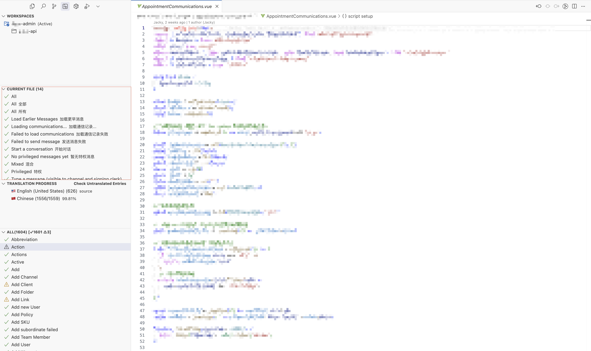
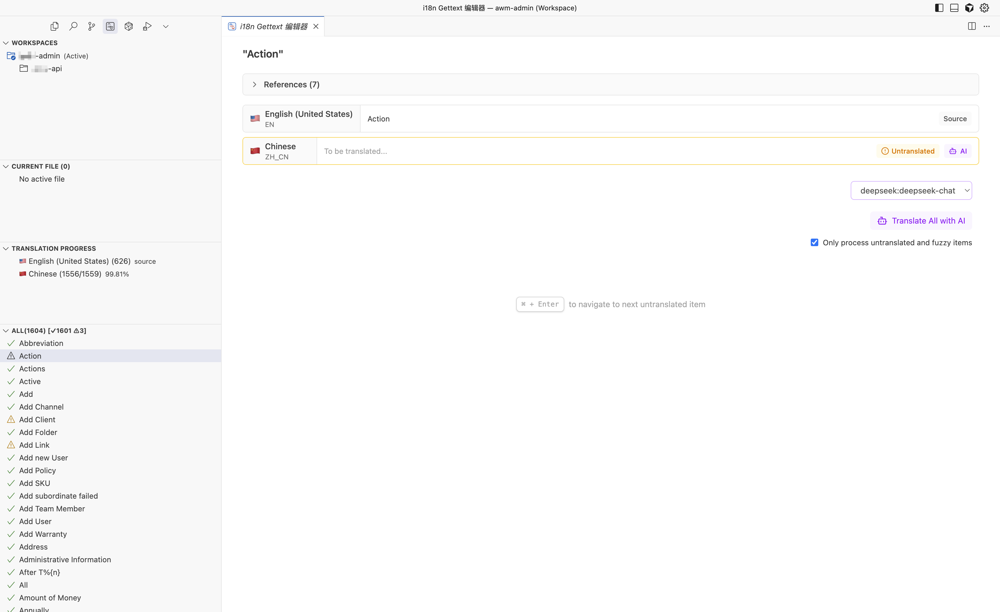

# 功能特性

i18n Gettext 为 VSCode 使用 GNU Gettext 的用户提供了全面的国际化翻译管理解决方案，集成了先进的 AI 翻译，大幅提升翻译效率和质量。

## 核心功能

### 🌍 统一翻译管理

集中管理项目中所有的 PO 翻译文件，支持：
- 多语言项目的统一视图
- 跨文件翻译条目搜索
- 翻译进度统计和可视化
- 支持 Gettext 标准格式



### 🤖 AI 智能翻译

支持 20+ 主流 AI 提供商，提供高质量翻译服务：

| 提供商 | 支持模型 |
|--------|----------|
| **OpenAI** | GPT-4o, GPT-4, GPT-3.5 |
| **Anthropic** | Claude-3 系列 |
| **Deepseek** | deepseek-chat |
| **Google** | Gemini Pro, Gemini Flash |
| **Mistral** | Mistral Large, Medium |
| **Groq** | Llama3, Mixtral |

> 更多支持的 AI 提供商，请参考[AI SDK文档](https://ai-sdk.dev/docs/foundations/providers-and-models)。

#### AI 翻译特性
- **批量翻译**：一键翻译多个条目
- **上下文感知**：理解代码上下文，提供准确翻译
- **质量审查**：AI 自动检查翻译质量
- **自定义提示词**：针对特定项目优化翻译效果

### 📊 可视化翻译进度

实时跟踪项目翻译状态：
- 按语言统计翻译完成度
- 直观的进度条显示
- 未翻译条目快速定位
- 翻译质量评估

### 🔍 强大的搜索功能

快速定位需要处理的翻译：
- **全文搜索**：在所有翻译条目中搜索
- **筛选器**：按翻译状态、文件、语言筛选
- **快捷导航**：直接跳转到对应代码位置

### 📝 专业翻译编辑器

专门设计的翻译界面：
- **并排编辑**：源语言和目标语言对比显示
- **实时预览**：即时查看翻译效果
- **快捷键支持**：Ctrl+Enter 快速跳转下一条
- **自动保存**：防止翻译丢失



### 🔗 无缝代码集成

与开发工作流深度整合：
- **定义跳转**：从代码直接跳转到翻译条目
- **引用查找**：查看翻译条目在代码中的使用位置
- **文件同步**：编辑代码时自动显示相关翻译

### 🔢 智能过滤系统

- **状态过滤**：显示全部/已翻译/未翻译/模糊匹配

## 高级特性

### ⚡ 批量翻译


### 🛠️ 灵活配置系统

适应各种项目结构：

```json
{
  "i18n-gettext.localesConfig": {
    "type": "nested", // flat, nested, custom
    "basePath": "src/language", // 翻译文件基础路径
    "pattern": "${locale}/${domain}.po", // 文件名模式
    "defaultDomain": "app", // 默认域名
    "sourceLanguage": "en-US" // 源语言
  }
}
```
