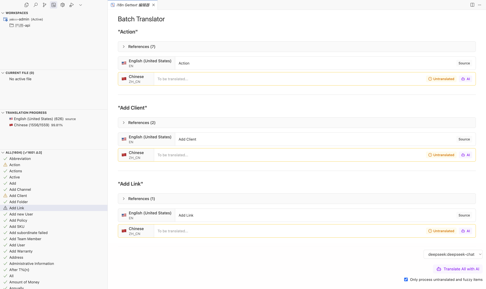

# 快速开始

在几分钟内开始使用 i18n Gettext，提升您的国际化翻译效率。

## 系统要求

- **VSCode**: 1.89.0 或更高版本
- **操作系统**: Windows、macOS、Linux
- **网络连接**: 使用 AI 翻译功能需要网络连接

## 安装步骤

### 1. 安装扩展

有两种安装方式：

#### 方式一：VSCode 市场
1. 打开 VSCode
2. 按 `Ctrl+Shift+X` (Windows/Linux) 或 `Cmd+Shift+X` (macOS) 打开扩展面板
3. 搜索 "i18n Gettext"
4. 点击 "安装" 按钮

#### 方式二：命令行安装
```bash
code --install-extension akino.i18n-gettext
```

### 2. 验证安装

安装完成后，您会在活动栏看到 i18n Gettext 图标

## 基础配置

### 1. 配置翻译文件路径

打开 VSCode 设置 (`Ctrl+,`)，搜索 "i18n-gettext"，配置以下选项：

```json
{
  "i18n-gettext.localesConfig": {
    "root": ".", // 项目根目录
    "type": "nested", // 文件组织方式
    "basePath": "src/language", // 翻译文件目录
    "pattern": "${locale}/${domain}.po", // 文件路径模式
    "defaultDomain": "app", // 默认域名
    "sourceLanguage": "en-US" // 源语言
  }
}
```

### 2. 支持的文件组织方式

根据您的项目结构选择合适的类型：

#### Nested (推荐)
```
src/language/
├── en-US/
│   ├── app.po
│   └── common.po
├── zh-CN/
│   ├── app.po
│   └── common.po
└── fr-FR/
    ├── app.po
    └── common.po
```

#### Flat
```
src/language/
├── en-US.app.po
├── en-US.common.po
├── zh-CN.app.po
├── zh-CN.common.po
├── fr-FR.app.po
└── fr-FR.common.po
```

#### Custom

使用自定义模式，如：`${locale}/LC_MESSAGES/${domain}.po`

## AI 翻译配置

### 1. 选择配置方式

推荐使用 VSCode 设置配置 AI 模型：

```json
{
  "i18n-gettext.aiConfig": {
    "ai": [
      {
        "provider": "openai",
        "modelId": "gpt-4o",
        "apiKey": "your-openai-api-key",
        "baseURL": "https://api.openai.com/v1"
      }
    ]
  }
}
```

### 2. 支持的 AI 提供商

| 提供商 | 配置示例 | 说明 |
|--------|----------|------|
| **OpenAI** | `"provider": "openai"` | 需要 API Key |
| **Deepseek** | `"provider": "deepseek"` | 中文优化，性价比高 |
| **Anthropic** | `"provider": "anthropic"` | Claude 模型 |
| **Google** | `"provider": "google"` | Gemini 模型 |
| **Ollama** | `"provider": "ollama"` | 本地模型，免费 |

### 3. 安全配置（可选）

为了保护 API 密钥，也可以创建 `.i18n-gettext.secret` 文件：

```json
{
  "ai": [
    {
      "provider": "deepseek",
      "modelId": "deepseek-chat",
      "apiKey": "sk-your-deepseek-key"
    }
  ]
}
```

## 第一次使用

### 1. 打开翻译面板

点击活动栏的 i18n Gettext 图标，您会看到四个主要面板：
- **Workspaces**: 工作区选择器
- **Current File Translations**: 当前文件翻译
- **Translation Progress**: 翻译进度
- **Translation Entries**: 翻译条目列表

### 2. 查看翻译进度

在 "Translation Progress" 面板中，您可以看到：
- 各语言的翻译完成度
- 总条目数和已翻译数量
- 进度条可视化显示


### 3. 开始翻译

#### 单个翻译
1. 在 "Translation Entries" 面板选择未翻译的条目
2. 点击编辑图标
3. 在弹出的编辑器中输入翻译或使用 AI 翻译

#### 批量翻译
1. 点击 "Translation Progress" 面板标题栏的 "Check Untranslated Entries"
2. 在批量翻译界面中选择 AI 模型
3. 点击 "Translate All with AI" 开始批量翻译



## 常用快捷键

| 快捷键 | 功能 |
|--------|------|
| `Ctrl+Enter` / `Cmd+Enter` | 在翻译编辑器中跳转到下一个未翻译条目 |
| `Ctrl+Shift+P` | 打开命令面板，搜索 i18n Gettext 命令 |

## 命令面板功能

按 `Ctrl+Shift+P` 打开命令面板，输入 "i18n" 查看所有可用命令：

- **i18n Gettext: Search Entries** - 搜索翻译条目
- **i18n Gettext: Filter Untranslated** - 显示未翻译条目
- **i18n Gettext: Refresh Translations** - 刷新翻译数据
- **i18n Gettext: Extract Strings** - 提取翻译字符串
- **i18n Gettext: Compile Translations** - 编译翻译文件

## 常见问题

### Q: 找不到 PO 文件？
A: 检查 `basePath` 和 `pattern` 配置是否正确匹配您的文件结构。

### Q: AI 翻译失败？
A: 确认 API Key 正确，网络连接正常，以及选择的模型可用。

### Q: 翻译编辑器无法打开？
A: 尝试刷新翻译数据，或重启 VSCode。

如果遇到其他问题，请查看 [GitHub Issues](https://github.com/akinoccc/i18n-gettext/issues) 或提交新的问题。
