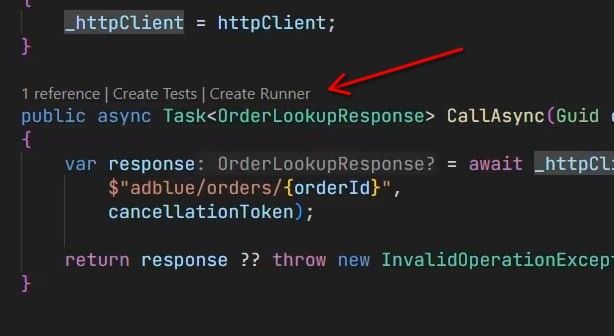
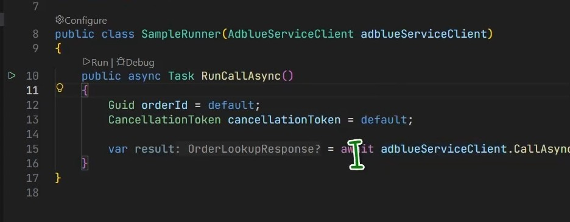
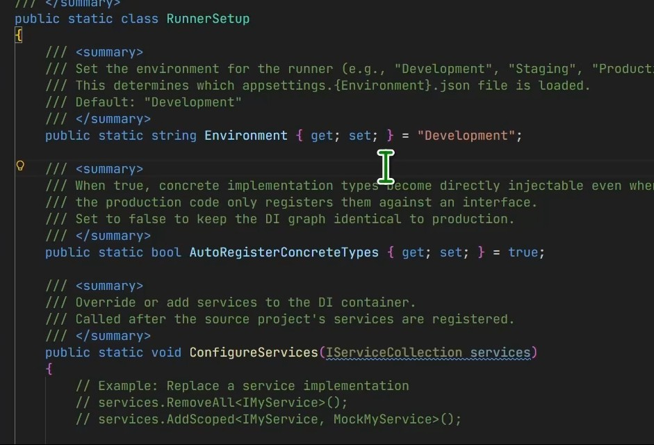
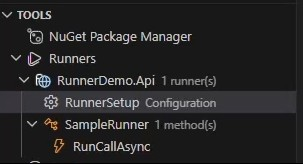

# C# Dev Tools 1.6.0 — C# Runners

Below is a short overview of the new **C# Runners** feature, along with a video tutorial that shows the full workflow step by step.

  <a href="https://youtu.be/qnWzkcfa-fo" target="_blank" rel="noreferrer" style="display:inline-block;max-width:800px;width:100%;position:relative;border-radius:12px;overflow:hidden;box-shadow:0 16px 40px rgba(0,0,0,0.24);text-decoration:none;">
    
    
      
        
      
    
  </a>

## What are C# Runners?

C# Runners let you quickly run or debug a specific method without having to start the entire application.

This is ideal when you want to verify a piece of code buried deep inside an application that uses dependency injection, without bringing up endpoints, payloads, or the full end-to-end flow.

> **Note**: Runners are supported only for projects that contain a `Program.cs` file and use the .NET generic host / DI container (`IServiceCollection`) — Web APIs, Worker Services, and similar host-based projects.

---

## Create a runner directly from the editor

In the editor, you can click **Create Runner** from the CodeLens, then provide a runner name. The extension creates a new project with a runner class that you can immediately run or debug.

Once the runner file is created, you get a ready-made starting point for working with methods, parameters, and injected dependencies.

---

## Runner configuration

The runner has its own configuration panel where you can set the environment, enable automatic concrete type registration, and control how DI services are overridden.

By default, the environment is set to `Development`, but you can switch it to `Production` so the runner loads the appropriate `appsettings.{Environment}.json` file.

---

## Runner Explorer

In Runner Explorer, you can see a structured tree of all runners, their configuration, and the methods you can run or debug.

---

## Why is this useful?

- you can debug a single method instead of the whole project
- you can easily inspect code that uses dependency injection
- you can switch environments and configuration quickly without manually starting the full application
- you still benefit from full C# LSP features such as hovers, go to definition, and quick fixes

If you want to try this feature, just create a new runner from the editor or from the Tools panel under the Runners section.

---

📖 **[Read the full C# Runners documentation](https://jakubkozera.github.io/vsc-csharp-dev-tools/tools/runners/)**