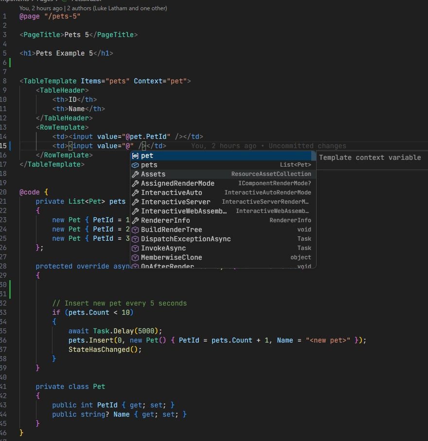
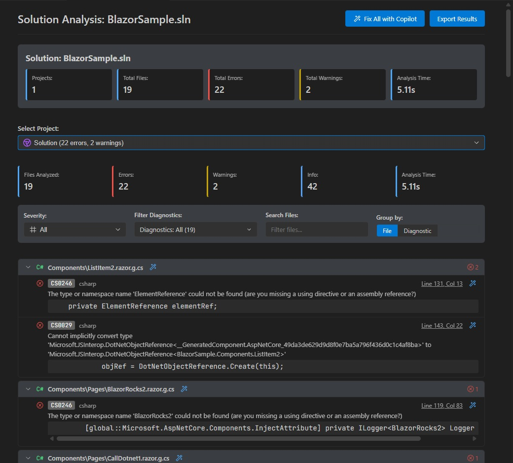

# C# Dev Tools 1.2.0 — Razor/Blazor IntelliSense & Project Analysis

Two major features land in **1.2.0**: full language support for `.razor` and `.cshtml` files, and an interactive code analysis tool for projects and solutions.

---

## Razor & Blazor IntelliSense

C# Dev Tools now provides rich IntelliSense for **Blazor components** (`.razor`) and **ASP.NET Razor Pages** (`.cshtml`) — powered by the Razor compiler and Roslyn.



### Autocomplete

- Typing `@` in markup **automatically triggers completions** — no Ctrl+Space needed
- Members from your `@code` block (fields, properties, methods) appear with proper priority ordering:
  - **Parameters** of the current method first
  - **Private members** next
  - **Protected / ComponentBase members** (e.g. `StateHasChanged`, `InvokeAsync`) after
  - **Methods**, then keywords last
- Type noise (classes, interfaces, namespaces, etc.) is **filtered out** — only relevant members shown

### Template Context Variables

When using generic template components with `Context="pet"`, the context variable is automatically detected and offered as the **top completion item** inside child content:

```razor
<TableTemplate Items="pets" Context="pet">
    <RowTemplate>
        <td>@pet.<!-- 'pet' is now the first suggestion --></td>
    </RowTemplate>
</TableTemplate>
```

### Other IntelliSense Features

| Feature | Details |
|---------|---------|
| **Go to Definition** | Navigate to `@code` members, component tags, `@inject` services, `@rendermode` values |
| **Hover** | Full XML documentation, method signatures, return types |
| **Rename** | Rename symbols across Razor files with correct source mapping |
| **Semantic Tokens** | Component tags (PascalCase) highlighted as types |
| **Formatting** | Smart indentation on Enter inside `@code`, `@if/else/for/foreach`, HTML tags |
| **Syntax Highlighting** | TextMate grammars for `.razor` and `.cshtml` with embedded C# + HTML |
| **Emmet** | HTML abbreviation expansion enabled by default in Razor files |

---

## Project & Solution Code Analysis

Analyze all diagnostics across an entire project or solution with a single click.



### How to use

1. Right-click any `.csproj` file in Solution Explorer → **Analyze Project**
2. Right-click any `.sln` / `.slnx` file → **Analyze Solution**
3. An interactive results panel opens showing all errors, warnings, and hints

### Features

- **Filter by severity** — quickly focus on errors only, or include warnings and hints
- **Search** — filter by message text or file name
- **Click to navigate** — jump directly to any diagnostic in the source file
- **Export to JSON** — save the full results for documentation or CI/CD pipelines

---

## Other Improvements

- **Completion type hints** — return types and property types shown inline in the autocomplete list. Configurable via `csharp-dev-tools.roslyn.showCompletionTypeHints`

---

## Report Issues

Found a bug or have feedback? Open an issue on GitHub:

**[https://github.com/jakubkozera/vsc-csharp-dev-tools/issues](https://github.com/jakubkozera/vsc-csharp-dev-tools/issues)**

Thank you for using C# Dev Tools!
