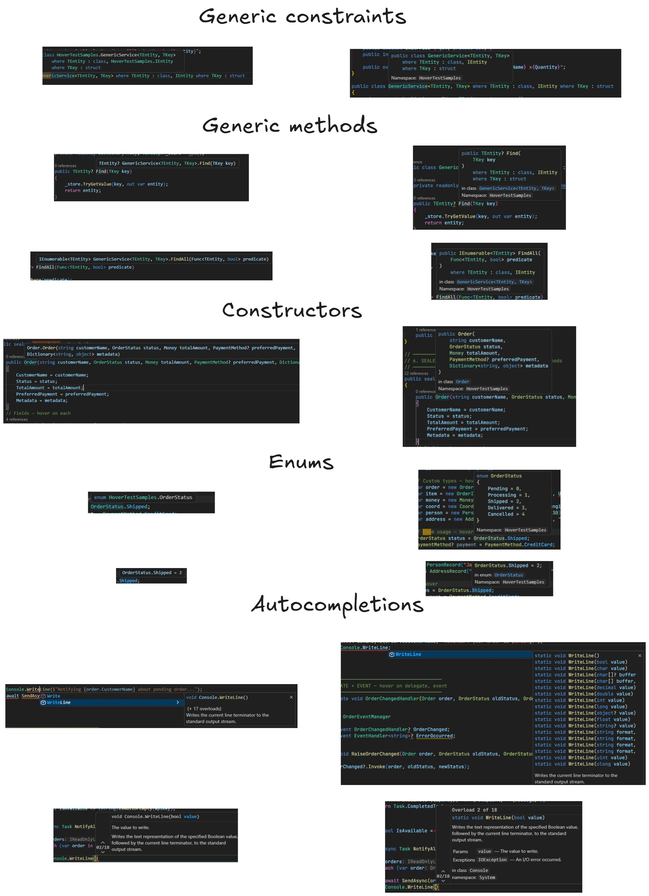

# C# Dev Tools 1.0.0 — Now Fully Standalone

We're excited to announce **C# Dev Tools 1.0.0**, a major milestone. The extension is now **fully self-contained** — no external C# LSP extension dependencies required.

---

## What Changed

### Language Server (LSP)

C# Dev Tools now ships its own **Language Server Protocol implementation** based on Roslyn. You no longer need to install the Microsoft C# extension or DotRush to get IntelliSense, code navigation, and diagnostics.

> **Open VSIX / Cursor / VSCodium users:** this is especially relevant for you — DotRush is no longer required and is not bundled in the Open VSIX build.

#### Better Hovers — Comparison

Our new hover experience is richer than the baseline Microsoft C# extension. Below are placeholder screenshots from real scenarios:

**Old vs new hovers:**

### Debugger

The debugger experience is **identical to the Microsoft C# extension** — we ship the same underlying debug adapter. No changes to your launch configurations are required.

---

## Important: Avoid Duplicate LSP Providers

If you have both **C# Dev Tools** and one of the following installed at the same time, you will experience **duplicate hovers, double autocomplete suggestions, and potential conflicts**:

- **C# (ms-dotnettools.csharp)** — Microsoft's official C# extension
- **DotRush** — used previously on Open VSIX marketplaces
- **Any other extension that provides a C# Language Server**

**We strongly recommend uninstalling other C# LSP providers** if you are using C# Dev Tools 1.0.0.

### How to check & uninstall

1. Open the Extensions panel (`Ctrl+Shift+X`)
2. Search for `@installed C#`
3. If you see both **C# Dev Tools** and another C# extension providing IntelliSense — uninstall the other one

---

## Summary of Changes

| Area | Before | After |
|------|--------|-------|
| LSP | Required external extension | Built-in |
| Debugger | Required external extension | Built-in (same experience) |
| Open VSIX support | DotRush required | No dependencies |
| Hover quality | Basic | Enhanced (Roslyn-powered) |

---

## Report Issues

Found a bug or have feedback? Please open an issue on GitHub:

**[https://github.com/jakubkozera/vsc-csharp-dev-tools/issues](https://github.com/jakubkozera/vsc-csharp-dev-tools/issues)**

Thank you for using C# Dev Tools!
